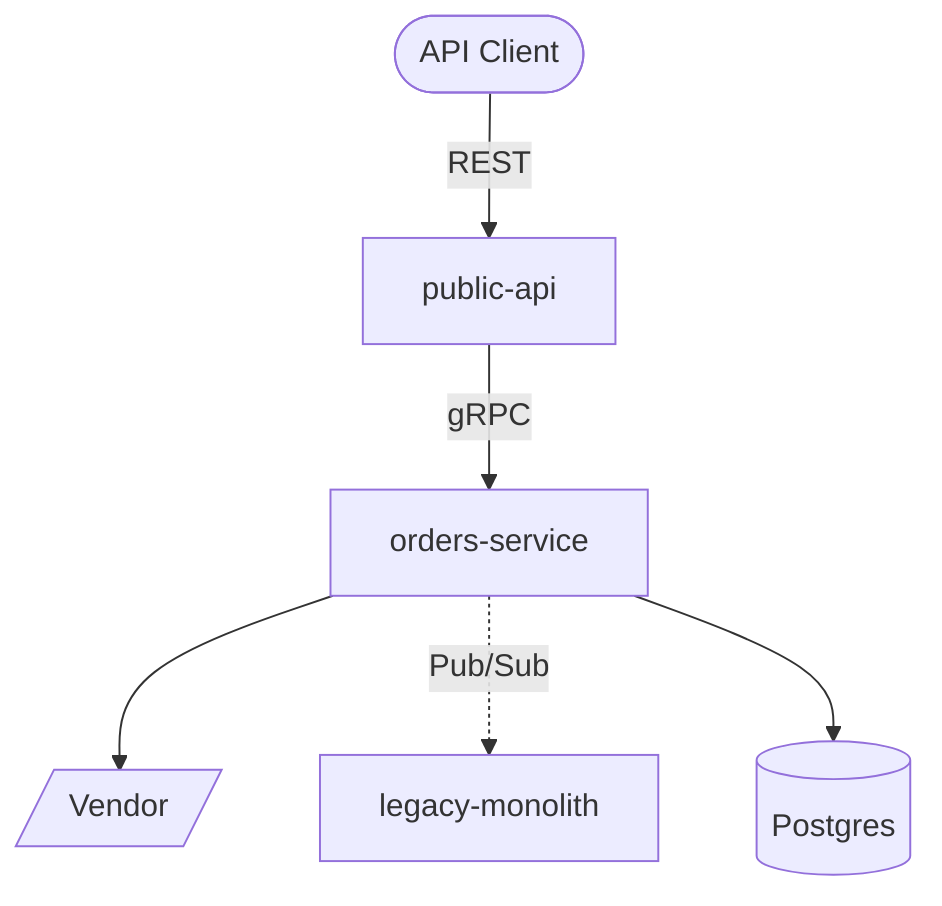
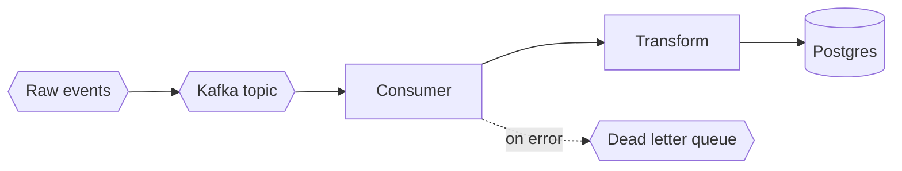
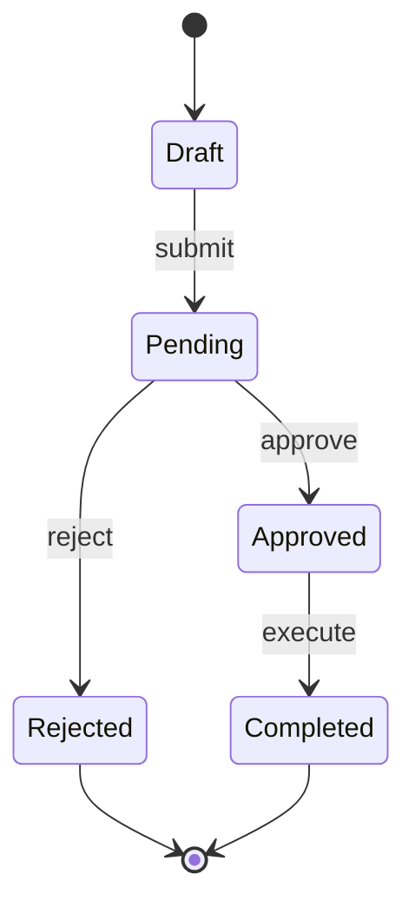

# Diagram rules (Phase 2)

Add diagrams wherever one of these is true:
- A request flow involves 3+ services
- There's a state machine with 4+ states
- The before/after of an architecture change is non-obvious
- A data pipeline has multiple stages

**Always use Mermaid. Never draw an ASCII diagram**, because Notion renders Mermaid as a real diagram and ASCII breaks with the font and the page width.

**Which Mermaid type to use:**

| Content | Format |
|---------|--------|
| Workflow, request flow, use case, anything with an order of messages | `sequenceDiagram` |
| Component architecture | `flowchart TD` |
| State machine | `stateDiagram-v2` |
| Data pipeline | `flowchart LR` |

## Mermaid Sequence Diagram Rules

- Put the diagram in a fenced code block with the `mermaid` language tag. Notion renders it as a diagram.
- Always use `autonumber`, and match the numbered steps under the diagram to it.
- Declare every participant with a short alias and a readable label: `participant API as Public API`.
- Use `actor` for humans and `participant` for systems.
- Use `->>` for requests and `-->>` for responses.
- Use `alt` / `else` for branches, `opt` for optional steps, `loop` for retries and polling, and `par` for parallel calls.
- Use `Note over X,Y:` to mark pain points (current workflow) or changes (new workflow).
- Keep one diagram to 15 messages or fewer. If a flow is longer, split it into two diagrams.
- Use the names from the Terms table for participants and messages.
- Never put `;` or `#` in a message or a note: Mermaid reads `;` as the end of a statement and `#` as the start of an entity code, so the diagram breaks. Use `,` or "then".

## Mermaid Flowchart Rules (architecture and data pipelines)

- Use `flowchart TD` for architecture and `flowchart LR` for a pipeline.
- Give each node a short ID and a readable label: `Orders[orders-service]`.
- Use shapes for kinds: `([...])` client or actor, `[...]` service, `[(...)]` database, `{{...}}` queue or topic, `[/.../]` external vendor.
- Use `-->` for a sync call and `-.->` for an async event. Label an edge with `-->|gRPC|` when the protocol matters.
- Group the nodes of one system with `subgraph`.
- Keep one diagram to 12 nodes or fewer.

**Architecture example:**

**Data pipeline example:**

## Mermaid State Diagram Rules

- Use `stateDiagram-v2`, with `[*]` for the start and the end states.
- Label each transition with the event that causes it.

