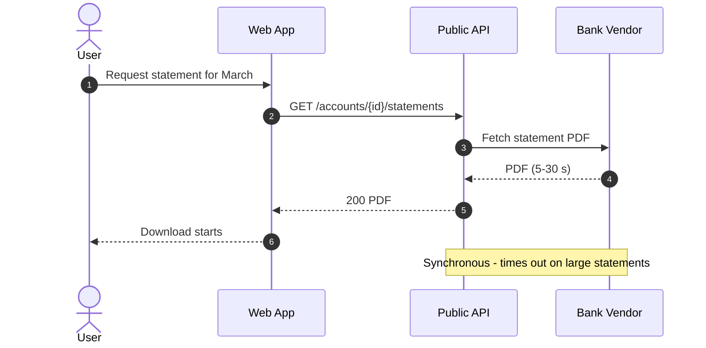
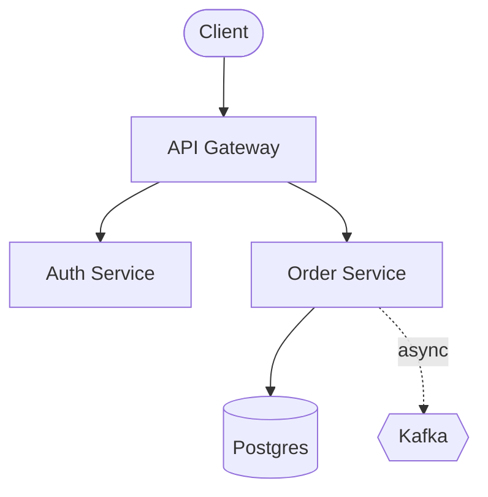
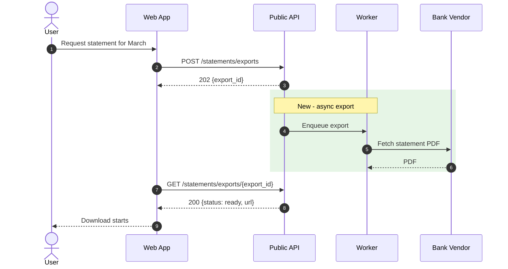
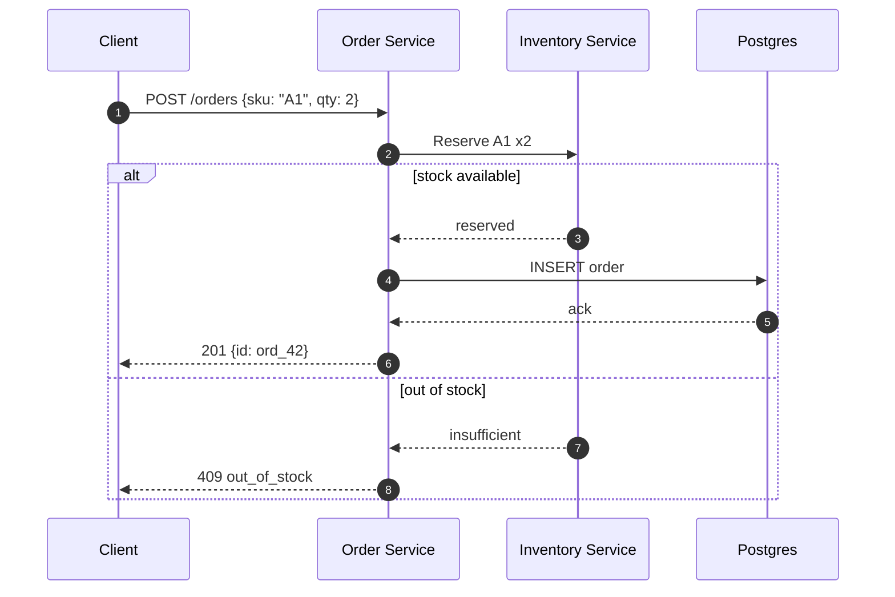

# Tech spec template (Phase 2)

Write every section below, in this order. If a section does not apply, skip it and write one sentence at its place that says why. NEVER leave a placeholder such as "TBD".

## Contents
- Header
- Table of contents
- Section 0 — Terms
- Section 1 — Problem Statement
- Section 2 — Goals & Non-Goals
- Section 2b — Industry Peers
- Section 3 — Background & Context (3.1 Current Workflow)
- Section 4 — Design Overview
- Section 4b — Use Cases
- Section 5 — Detailed Design (5.1–5.4)
- Section 6 — Alternatives Considered
- Section 7 — Cross-Cutting Concerns
- Section 8 — Rollout Plan
- Section 9 — Open Questions
- Section 10 — Appendix

## Header
```
# [Feature/System Name]

**Status:** Draft | In Review | Approved | Implemented
**Author:** [from user input, or leave blank]
**Reviewers:** [from user input, or leave blank]
**Created:** [output of `date -u +%Y-%m-%d`]
**Last Updated:** [output of `date -u +%Y-%m-%d`]
```

## Table of contents

Put a Notion table of contents block directly under the header, before Section 0, so a reader can jump to any section:

```
<table-of-contents />
```

Notion builds it from the headings, so write no list by hand.

---

### Section 0 — Terms

Put this table directly under the table of contents, before the Problem Statement. Define only the high-level concepts the whole design rests on - usually 3 to 6. If the spec has none, skip the section. Sort rows alphabetically.

| Term | Definition | Example | Not to be confused with |
|------|------------|---------|-------------------------|
| Approver | A user with the permission to accept or reject a Pending Action. | Bob, an admin of the same organization. | Reviewer - a code-review role. |
| Expiry Sweep | A scheduled job that rejects Pending Actions older than their TTL. | Runs every 5 minutes; rejects actions older than 72h. | Retry job - retries failed actions. |
| Pending Action | A write request that waits for a second user's approval before it runs. | A $50k payment created by Alice waits for Bob. | Draft - a draft has no approver yet. |

Rules:
- Add a term only if a reader must know it to follow more than one section.
- Do not add a term that the team's engineers already know (HTTP, gRPC, Kafka, the service names).
- Do not add code symbols, fields, endpoints, or RPC names (`line_gid`, `PostTags`). Explain them in Detailed Design where they appear.
- Use exactly the term from this table everywhere in the spec. Never introduce a synonym.
- Leave "Not to be confused with" blank only if no near-miss term exists.

---

### Section 1 — Problem Statement

One focused paragraph. Answer:
- What is broken, missing, or inefficient today?
- What is the user/business pain?
- Why does it matter now?

No solution in this section. Pure problem framing.

---

### Section 2 — Goals & Non-Goals

**Goals** — numbered list of measurable, outcome-oriented goals.
- Each goal should be verifiable: "Reduce p99 latency to <200ms" not "Improve performance"
- Include user-facing AND technical goals

**Non-Goals** — explicit list of what this design does NOT solve.
- Non-goals prevent scope creep. Be specific.
- Example: "Out of scope: mobile push notifications"

Rules for both lists:
- Name only work that belongs to this ticket. Never list work of another ticket or a change to another endpoint (for example "2FA for an existing endpoint - separate ticket").
- Never list logic that already exists (for example "physical cards cannot get a replacement - the issuer ships a new plastic card"). Put an existing fact in Background & Context.
- List a non-goal only if someone asked for it (the ticket, the user, a stakeholder) and the design does not do it. Never list a thing that nobody asked for and that the design leaves as the current behavior does (for example "no 2FA on the API path - the existing endpoint has none, and this one follows it").

---

### Section 2b — Industry Peers

Show how comparable products solve the same problem, so a reader sees the design against the market before the details. Put it here, near the top, never in the Appendix.

Write one comparison table. One column for this design (first), one column for each industry peer. One row for each dimension that matters to the design. Keep only the rows that differ. Link each peer's name to the docs page that the facts come from. Write "not documented" when a peer's docs say nothing; never guess.

| Dimension | This design | Peer A | Peer B |
|-----------|-------------|--------|--------|
| Endpoint | `POST /v1/exports` | `POST /reports` | `GET /statements?async=true` |
| Response | `202 {export_id}` | `200 {report_id}` | `202` + webhook |
| Repeat request | Same result | not documented | `409` |

Write only the table: no bullets, no summary, no prose under it. The reasons for the design belong in Detailed Design and Alternatives Considered.

If no peer was researched, write one sentence that says so.

---

### Section 3 — Background & Context

Only include if context is non-obvious to the reader.
- How does the current system work?
- What has been tried before?
- Relevant constraints or history

#### 3.1 — Current Workflow

**Always include a high-level Mermaid sequence diagram of the current workflow.** Keep it to the main actors (user, client, 2-5 services, external vendors). Skip internal function calls.



Under the diagram, repeat the flow as numbered steps that match the `autonumber` labels. Add the pain point to the step where it happens:

1. The user asks for the March statement in the web app.
2. The web app calls `GET /accounts/{id}/statements`.
3. The API calls the vendor and blocks. **Pain:** a large statement takes 30 s and the gateway times out at 29 s.
4. ...

Add a Mermaid `flowchart` of the current architecture only if the architecture (not the flow) is non-obvious.

---

### Section 4 — Design Overview

High-level summary of the solution in 2-4 paragraphs. A senior engineer should understand the approach after reading this section alone.

**Always include a high-level Mermaid architecture diagram** (`flowchart`) showing:
- Components involved
- Data/request flow direction
- External dependencies

Example diagram style:


**Also include a Mermaid sequence diagram of the new high-level workflow**, with the same actors as Section 3.1 so the reader can compare them side by side. Use `rect` blocks or `Note` lines to mark what changed:



---

### Section 4b — Use Cases

List every use case the design supports. For each one, write a worked example with concrete values and numbered steps. Cover at least:
- the happy path
- one failure or edge case per external dependency
- one permission or validation rejection

Format each use case like this:

```
#### UC-1 — Admin downloads a large statement (happy path)

**Actor:** Organization admin
**Precondition:** Account acc_123 has 4,000 transactions in March.
**Trigger:** The admin clicks "Download March statement".

Steps:
1. The web app sends POST /statements/exports {account_id: acc_123, month: 2026-03}.
2. The API validates access and returns 202 {export_id: exp_9}.
3. The worker fetches the PDF from the vendor in 25 s and stores it.
4. The web app polls GET /statements/exports/exp_9 and gets status=ready.
5. The admin downloads the file from the signed URL (valid for 15 min).

**Result:** The admin has the PDF. No request runs longer than 1 s.

#### UC-2 — Vendor is down (failure)
...
```

Add a Mermaid sequence diagram to a use case only if its flow differs from the main diagram in Section 4 (for example, a retry loop or a compensation step). Use `alt`, `opt`, and `loop` blocks for branches.

---

### Section 5 — Detailed Design

This is the meat of the document. Subsections as needed:

#### 5.1 — [Component / Flow Name]

- How does it work step by step?
- Use numbered lists for sequential flows
- Give one concrete example per flow, with real-looking values (IDs, amounts, timestamps)
- Use Mermaid sequence diagrams for async or multi-party flows. Show errors with `alt` blocks:



Follow each diagram with numbered steps that match the diagram numbers.

#### 5.2 — Data Model

Show new tables, fields, or schema changes. Use a table format:

| Field | Type | Nullable | Description |
|-------|------|----------|-------------|
| id | UUID | No | Primary key |
| ... | ... | ... | ... |

For schema migrations: show before/after or the migration steps.

#### 5.3 — API / Interface Changes

For each new or modified endpoint:

```
POST /v1/resource

Request:
{
  "field": "string",
  "amount": number
}

Response 200:
{
  "id": "uuid",
  "status": "created"
}

Errors:
- 400: Invalid input — [conditions]
- 409: Conflict — [conditions]
```

#### 5.4 — Key Algorithms / Business Logic

Explain non-trivial logic in plain language. Use pseudocode only if it genuinely helps. Prefer prose + bullets over walls of pseudocode.

---

### Section 6 — Alternatives Considered

Include every alternative found in Phase 1 Step 1b, plus any the user named in Step 3. Leave out an alternative that is only "do what a peer does" when the Industry Peers table (Section 2b) already shows it; the table is enough. Minimum 2 alternatives. Even "do nothing" counts as an alternative. Never invent a rejection reason - if the conversation gives none, list it as an Open Question.

Start with a summary table. Write one row per dimension, one column per option, and keep only the rows that differ:

| Dimension | Chosen: Async export | Alt A: Raise gateway timeout | Alt B: Nightly pre-generation | Do nothing |
|-----------|----------------------|------------------------------|-------------------------------|------------|
| Max request time | < 1 s | 120 s | < 1 s | 29 s, then fails |
| Vendor calls / day | On demand | On demand | 1 per account per day | On demand |
| New infra | Queue + worker | None | Cron + storage | None |
| Fresh data | Yes | Yes | Up to 24 h old | Yes |

Then write one subsection per alternative:

```
#### Alt A — Raise the gateway timeout to 120 s

**How it works:**
1. Change the load balancer timeout from 29 s to 120 s.
2. Keep the synchronous call to the vendor.

**Example:** A 4,000-transaction statement returns after 25 s instead of failing.

**Pros**
- No new components - one config change.

**Cons**
- Holds a connection open for up to 120 s, which limits concurrency.
- The vendor can still take longer than 120 s at month end.

**Why rejected:** <the reason itself, as a fact about the design. Never cite the conversation, a drill question, or an alignment document. Cite only code, docs, tickets, or external pages that a reader can open.>
```

Put the chosen design first in the table, so the reader sees the comparison against it.

---

### Section 7 — Cross-Cutting Concerns

#### Security
- Authentication / authorization model
- Input validation
- Any sensitive data exposure risk

#### Privacy
- PII involved? How is it handled, stored, deleted?
- GDPR / CCPA implications if any

#### Performance
- Expected load (QPS, data volume)
- Bottlenecks and how they're addressed
- Caching strategy if applicable

#### Observability
- Key metrics to track (latency, error rate, throughput)
- Alerts to add
- Logging strategy (what to log, what NOT to log)

#### Testing Strategy
- Unit tests: what logic is unit-tested
- Integration tests: what flows are covered
- Load/stress testing if relevant

---

### Section 8 — Rollout Plan

- Feature flag? Shadow mode? Gradual rollout?
- Migration steps (if data migration required)
- Rollback strategy — how do we undo this if something goes wrong?
- Monitoring during rollout — what signals indicate success or failure?

---

### Section 9 — Open Questions

Number each open question. Include owner and target resolution date if known.

| # | Question | Owner | Due |
|---|----------|-------|-----|
| 1 | Should we rate-limit per user or per IP? | @team | YYYY-MM-DD |

---

### Section 10 — Appendix *(optional)*

Supplementary material: links, reference docs, prior art, data analysis, etc. Keep the main doc clean — move deep detail here.

---
