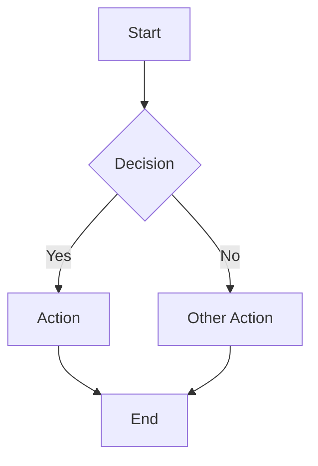
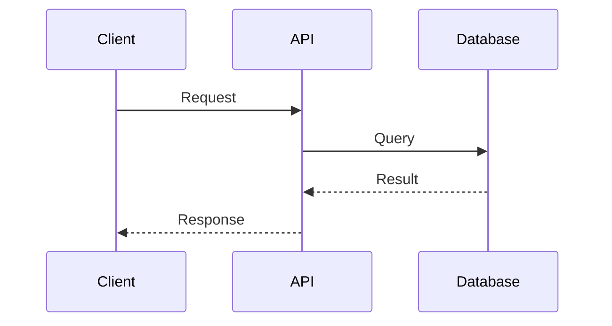
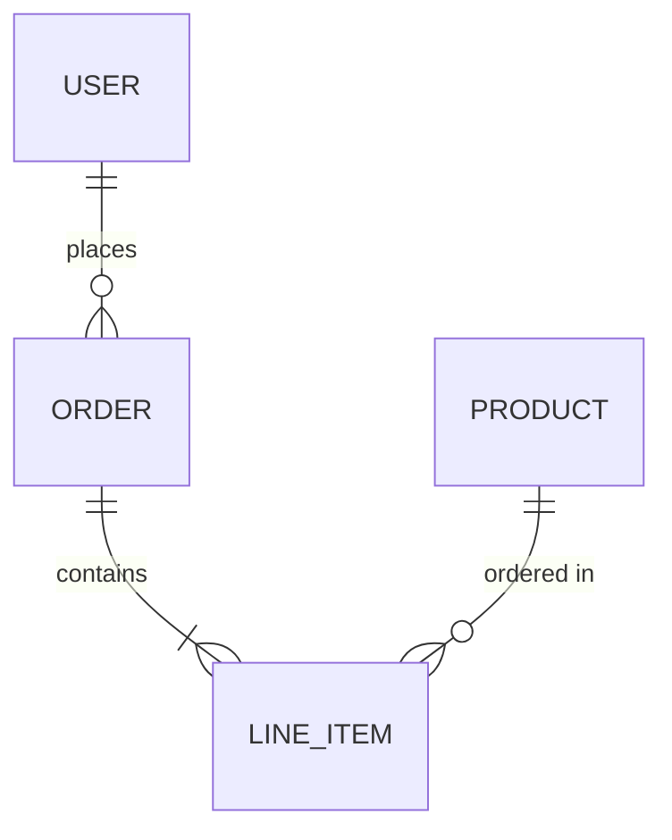
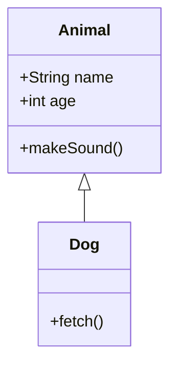
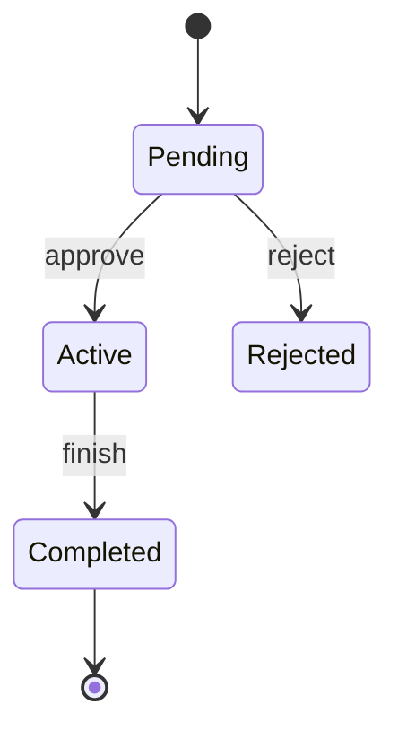

# Diagram

Draw one Mermaid diagram from code or a description, and save it.

## Local configuration

Read `diagrams.dir` in `~/.claude/config.local.json`: the folder for the files. If it is missing, ask the user for a folder, and add it to the config. Expand a leading `~` to the home directory.

## Arguments

```
/diagram <subject> [--flowchart | --sequence | --class | --er | --state | --architecture]
```

| Type | Best for | Mermaid keyword |
|------|----------|-----------------|
| Flowchart | Function logic, decision trees, processes | `flowchart TD` or `flowchart LR` |
| Sequence | API calls, service interactions, request/response | `sequenceDiagram` |
| Class | ORM models, class relationships, inheritance | `classDiagram` |
| ER | Database schemas, table relationships | `erDiagram` |
| State | State machines, status transitions | `stateDiagram-v2` |
| Architecture | System components, C4 model | `flowchart` with subgraphs |

## Workflow

### Step 1 — Choose the type

Use the type flag if one is given. Otherwise, pick the type from the subject:

| The subject is | Type |
|---|---|
| A function with conditions or loops | Flowchart |
| An API endpoint or a service call | Sequence |
| Database models or an ORM | ER, or Class |
| A state machine or a status field | State |
| A system overview | Architecture |
| Class inheritance or relationships | Class |

If two types fit equally well, ask with AskUserQuestion, with the best one first, marked "(Recommended)". Otherwise, continue.

### Step 2 — Gather the context

If the subject is code, read the source files, and take the components, functions, or classes, how they flow or relate, and the main decision points and interactions.

### Step 3 — Draw

Keep one concept in each diagram, with clear labels and at most 10–15 nodes. Use `TD` for hierarchies and `LR` for flows. Use Mermaid notes to explain a point.











### Step 4 — Save

Write `<diagrams.dir>/<subject>_<type>.md`, for example `order_placement_sequence.md` or `customer_account_er.md`. If the file exists, ask before you replace it.

````markdown
# <Title>

<One or two sentences: what the diagram shows.>

## Diagram

```mermaid
<diagram>
```

## Notes

- <What is included or left out, and each assumption>

---
Generated from: <source files, if any>
````

### Step 5 — Show

Show the diagram in the reply, the saved path, and the notes. The diagram renders in GitHub, GitLab, Notion, Obsidian, and VS Code with a Mermaid extension. If `mmdc` (mermaid-cli) is installed, `mmdc -i <file>.md -o <file>.png` makes a PNG.

## Examples

- `/diagram the order placement flow`
- `/diagram customer account models --er`
- `/diagram kafka event handling --sequence`
- `/diagram payments service architecture`

## Retry

If the user says "retry", reuse nothing. Read the source files again, and run the workflow from Step 1.
