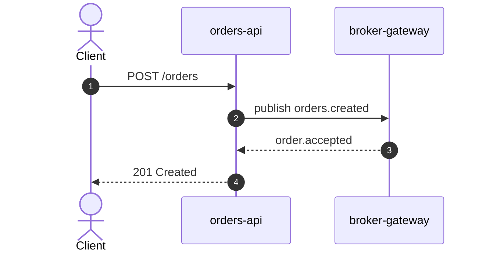
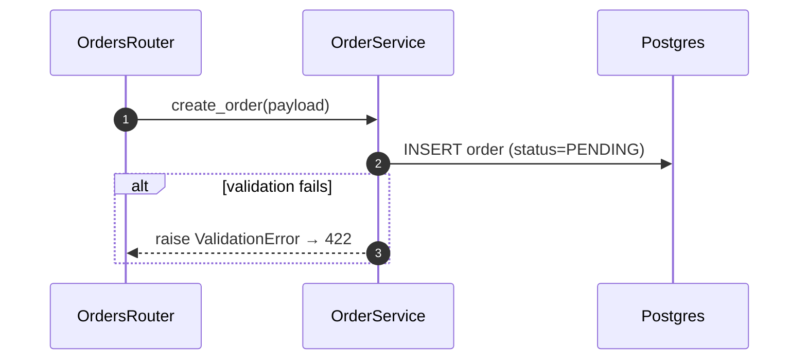

# Document Flow

Investigate one data flow or use case in the code. Write one Obsidian page that explains it
with sequence diagrams. Then give the user a link to open the page.

## Hard rules

- NEVER guess a vault path. Read it from `obsidian.flowsDir`.
- NEVER overwrite a page that exists without asking, because the user can have edited it.
- NEVER invent a step. Every step in a diagram has a `file:line` location, or it goes in "Open questions".
- NEVER change code. This skill reads code and writes one page in the vault. Use `git` only to read: `git rev-parse`, `git log`, `git ls-files`.
- Do not read or document tests. The page explains the production code only.

## Local configuration

Read `~/.claude/config.local.json` for these keys:

| Key | Use |
|---|---|
| `obsidian.flowsDir` | The vault folder for the page |
| `repos.root` | The parent folder of all service checkouts, for flows across services |

If `obsidian.flowsDir` is missing or empty, copy the `obsidian` block from
`config.example.json`, ask the user for the folder, and stop. NEVER guess a vault path.

If `repos.root` is missing, search only the current repository and the `--repos` paths.

## Arguments

```
/document-flow <topic> [--repos <path,path>] [--title "<title>"]
```

| Argument | Required | Description |
|---|---|---|
| `<topic>` | Yes | Free text: the flow or the use case, for example `order placement from API to broker` |
| `--repos <path,path>` | No | More repositories to search. Each value is a path, or a folder name under `repos.root` |
| `--title "<title>"` | No | The page title. Default: a title made from the topic |

If `<topic>` is empty, ask the user for it and stop.

## Defaults

| Field | Default | Override |
|---|---|---|
| Start repository | The current working directory | — |
| Other repositories | Found from the outbound calls (Phase 2) | `--repos` |
| Title | Title Case of the topic, 3–8 words | `--title` |
| File name | `<Title>.md` | — |

## Workflow

### Phase 1 — Find the Entry Point

1. Read the configuration. Stop if `obsidian.flowsDir` is missing.
2. Search the start repository for the topic. Use `Grep` for the key nouns and verbs of the topic.
3. Find the entry point of the flow. Typical entry points:
   - An HTTP route or a GraphQL resolver
   - A queue consumer, a topic subscriber, or a webhook handler
   - A scheduled job or a CLI command
4. If you find more than one possible entry point, pick the one that matches the topic best. Write the others under "Open questions".

### Phase 2 — Trace the Flow

Follow the call path from the entry point to the end of the flow. Read each function in full.

For each step, record:

| Field | Example |
|---|---|
| Participant | `orders-api`, `OrderService`, `Postgres`, `orders.created` topic |
| Action | `validates the order and saves it with status PENDING` |
| Location | `src/orders/service.py:88` |
| Data | The important fields that move to the next step |
| Failure | What happens on an error: retry, rollback, dead letter, error response |

**Follow calls across services.** When the code calls another service (HTTP client, queue
publish, topic publish, gRPC):

1. Record the call target: the URL path, the queue name, or the topic name.
2. Find the receiving repository. Search `--repos` first. Then `Grep` for the target under `repos.root`.
3. Continue the trace in the receiving repository from its handler.
4. If you cannot find the receiver, show it as an external participant. Write it under "Open questions".

If the flow touches three or more repositories, trace each repository with one `Explore`
agent in parallel. Give each agent the entry point and the fields to record (table above).


Stop the trace when the flow reaches a final state: a response to the caller, a saved
record, or a published event that nothing in scope consumes.

### Phase 3 — Write the Page

Write the page to `<obsidian.flowsDir>/<Title>.md`. If the file exists, ask the user to
overwrite it or to pick a new title, and stop.

Use this template:

````markdown
---
title: <Title>
created: <YYYY-MM-DD, from `date -u +%Y-%m-%d`>
updated: <YYYY-MM-DD>
tags: [flow, <service-1>, <service-2>, <domain-tag>]
source: <repository names and the commit of each, from `git rev-parse --short HEAD`>
aliases: []
---

# <Title>

> [!summary] TL;DR
> <Two sentences: what starts the flow, and what is the result.>

## Participants

| Participant | Kind | Repository | Role in this flow |
|---|---|---|---|
| `orders-api` | Service | `orders-api` | Receives the order request |
| `Postgres` | Database | — | Holds the order record |

## High-level flow

<One or two sentences that introduce the diagram.>



## <Service name> — detail

<Two to four sentences: what this service does in the flow.>



| Step | Location | Note |
|---|---|---|
| 1 | `src/orders/router.py:42` | <What happens, in one sentence> |
| 2 | `src/orders/service.py:88` | <What happens, in one sentence> |

<Repeat this section for each service.>

## Errors and edge cases

- <The condition, then what the code does, with the location.>

## Open questions

- <Anything the code did not answer: a missing receiver, two possible entry points, unclear config.>

## Related

- [[<Existing note>]]
````

Rules for the page:

- **One high-level diagram.** It shows only services, databases, queues, and external systems. It shows no classes and no functions.
- **One detailed diagram for each service.** It shows the classes and the functions inside that one service. It shows the other services as one participant each.
- If the flow stays in one service, keep the high-level diagram. Show the service as one participant with its database and its external calls.
- Use `autonumber` in every diagram. Use the same step numbers in the step table.
- Use `alt`, `opt`, and `loop` blocks for branches, optional steps, and retries.
- Write a `file:line` location for every step in the detailed diagrams.
- Keep each diagram to 15 messages or fewer. If a service needs more, split it into two detailed diagrams.
- Use participant names exactly as they are in the code: class names, topic names, table names.
- `Glob` the vault for notes whose names match a participant or the topic. Add the matches under "Related". Do not add a link to a note that does not exist.
- Leave out "Open questions" if there are none.

### Phase 4 — Share the Link

1. Make the Obsidian link from the absolute path of the page:
   ```bash
   python3 -c 'import sys, urllib.parse; print("obsidian://open?path=" + urllib.parse.quote(sys.argv[1], safe=""))' "<absolute page path>"
   ```
2. Output:
   ```
   📝 <Title>
   🔗 <obsidian:// link>
   📁 <absolute page path>

   Participants: <n> · Services: <n> · Open questions: <n>
   ```

Do not show the page content in the output. The user reviews it in Obsidian.

## Examples

- `/document-flow order placement from API to broker`
- `/document-flow password reset email --repos notifications,identity`
- `/document-flow how a deposit settles --title "Deposit Settlement Flow"`

## Retry

Say **"retry"** to re-run from scratch.

When retrying:
1. Do NOT use any cached information.
2. Re-read all code and the configuration fresh.
3. Ask before you overwrite the page from the last run.
